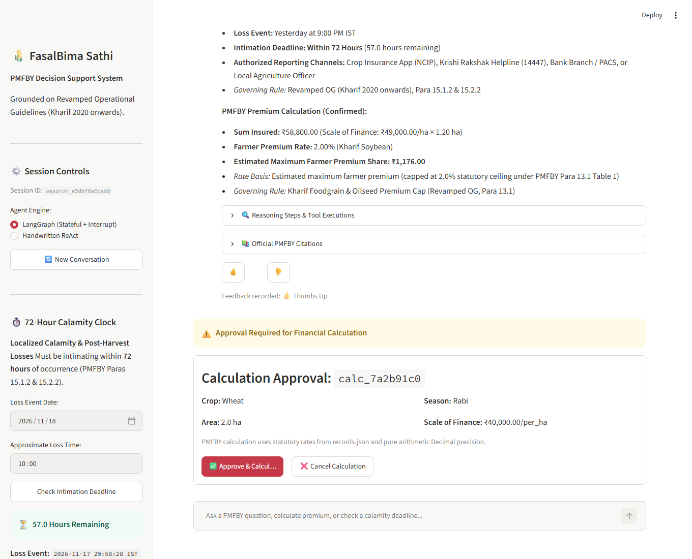

# FasalBima Sathi

An AI-powered assistant for the Pradhan Mantri Fasal Bima Yojana (PMFBY).

## Problem
Farmers often face difficulty understanding crop insurance guidelines, premium calculations, claim procedures, and statutory deadlines (such as the 72-hour localized calamity intimation window).

## Target Users
- Indian farmers (e.g., soybean, wheat, and cotton cultivators facing crop loss)
- Small and marginal farmers navigating statutory insurance benefits
- Agricultural extension workers and PACS (Primary Agricultural Credit Societies)

## Project Objectives
- Explain official PMFBY rules clearly and transparently.
- Provide pure arithmetic sum insured and premium calculations with documented statutory rates.
- Protect farmers from unauthorized calculations via human-in-the-loop approval gates.
- Track localized calamity intimation deadlines (72-hour rule) with real-time countdowns.
- Ground all advice with genuine citations (source PDF and page number) from official guidelines.

## Official Data Sources
- [PMFBY FAQ Portal](https://pmfby.gov.in/faq)
- [PMFBY Revamped Operational Guidelines (Kharif 2020 onwards)](https://pmfby.gov.in/pdf/Revamped%20OGs_Final.pdf)
- [PMFBY Revised Operational Guidelines (2016)](https://pmfby.gov.in/pdf/Revised_Operational_Guidelines.pdf)

---

## Current Progress (Days 1–10)
- **Day 1**: Python intro (`day01_intro.py`) and interactive menu (`day01_menu.py`).
- **Day 2**: 20 starter PMFBY records (`data/sample_records.py`), reusable record utilities (`app/records.py`), and terminal CLI (`app/cli.py`).
- **Day 3**: Official source downloader with manifest (`app/fetch.py`), `Record` dataclass (`app/models.py`), and PDF/HTML ingestion pipeline (`app/ingest.py` -> `data/records.json`).
- **Day 4**: FastAPI service (`app/main.py`), TF-IDF + cosine similarity search (`app/smart_search.py`), and pandas dataset analysis (`analysis/explore.py`).
- **Day 5**: LLM fundamentals guide with diagram (`docs/how_llms_work.md`) and 10 evaluation questions (`eval/questions.json`, `docs/questions.md`).
- **Day 6**: LLM provider wrapper supporting Groq & Gemini with offline rule fallback (`app/llm.py`), prompt engineering templates (`prompts/system_prompt.txt`, `prompts/task_v1_concise.txt`, `prompts/task_v2_detailed.txt`), `POST /chat` returning structured JSON (`answer`, `confidence`, `follow_up`), configuration template (`.env.example`), and evaluation report comparing both prompt versions (`eval/prompt_compare.md`).
- **Day 7**: Document chunking pipeline preserving source, page, and title (`app/chunking.py`), dense semantic embedding utilities (`app/embed.py`), persistent Chroma vectorstore (`app/vectorstore.py` with 1,786 indexed chunks), `GET /search/semantic` endpoint, and semantic evaluation report on 10 questions (`eval/search_results.md`).
- **Day 8**: Grounded RAG engine with strict citations and personal claim refusal (`app/rag.py`), `POST /ask` endpoint, 15-question evaluation suite (`eval/eval_set.json`), dual-configuration experiment script (`eval/run_eval.py`), and configuration winner table.
- **Day 9**: Agent tools (`app/tools.py` with pure arithmetic `pmfby_premium`, `pmfby_knowledge_search`, and `pmfby_claim_deadline_check`), hand-written ReAct loop (`app/agent_loop.py`), stateful LangGraph agent with native `interrupt()` and `Command(resume=...)` approval pause (`app/graph.py`), and unified `POST /agent` endpoint.
- **Day 10 (Checkpoint 2)**: Full-featured Streamlit Web UI (`ui/app.py`), signature 72-Hour Calamity Intimation Clock with countdown, approval card with Approve/Cancel actions, transparent tool execution traces, genuine citations, and thumbs-up/down feedback collection saved to `data/feedback.jsonl` with deduplication.

---

## Day 10: Streamlit Web UI & Checkpoint 2



### Key Features of the Streamlit Interface (`ui/app.py`):
1. **Clean Zero-Fabricated State**:
   - New sessions start with empty chat history, no pre-populated fake approvals, no unrequested clock calculations, and no preset feedback.
   - Includes an explicit, opt-in `📌 Demo` button for users wishing to inspect sample multi-part scenarios in an isolated session.
2. **Signature Feature — Live 72-Hour Calamity Intimation Clock**:
   - Implements PMFBY Revamped Guidelines Paras 15.1.2 & 15.2.2 (localized calamities: hailstorm, landslide, inundation, cloudburst, natural fire; and post-harvest losses up to 14 days for cut-and-spread crops).
   - Real-time automatic countdown via `@st.fragment(run_every="5s")` without full page reloads, recalculating remaining hours, minutes, and seconds from current `Asia/Kolkata` time against the fixed statutory deadline.
   - Clearly flags expired deadlines and lists official reporting channels (Crop Insurance App, Krishi Rakshak Helpline 14447, Bank Branch / PACS, Local Agriculture Officer).
   - Prominently displays statutory disclaimer that the clock calculates deadlines and does not file formal insurance claims.
3. **LangGraph Native Interrupt Approval Card**:
   - Pauses execution with native LangGraph `interrupt()` when financial calculations are requested.
   - Binds approvals strictly to immutable parameters and unique calculation IDs (`calc_<uuid>`).
   - Requires explicit `calculation_id` for approval or cancellation; rejects mismatched or missing IDs while preserving the pending state.
   - Approved calculations resume via `Command(resume=...)` to execute `pmfby_premium`; cancellations halt immediately without executing tools.
4. **Transparent Tool Traces & Official Citations**:
   - Collapsible expanders reveal exact reasoning steps, inputs/outputs of executed tools (`pmfby_premium`, `pmfby_claim_deadline_check`, `pmfby_knowledge_search`), and official PMFBY guideline citations with source document, page number, and semantic relevance.
5. **Farmer Feedback Collection**:
   - Thumbs-up (👍) and Thumbs-down (👎) feedback buttons keyed to stable assistant `response_id`s.
   - Thread-safe persistence with deduplication by `(thread_id, response_id)` (repeated votes update rather than duplicate; multiple responses in the same session remain isolated).
   - Excluded from git tracking (`data/feedback.jsonl` added to `.gitignore`).
6. **Strict Production Execution Architecture**:
   - UI communicates with the FastAPI service via HTTP with client `request_id` idempotency.
   - Displays clear connection and timeout errors rather than silently executing locally on failure.

---

## Day 9: Agent Architecture & Accuracy Guarantees

### 1. Pure Arithmetic Premium Tool (`app/tools.py`)
- **Sum Insured**: $\text{Scale of Finance} \times \text{Insured Area}$.
- **Units Isolation**: Tracks `area_unit` (`ha`, `acre`) and `scale_of_finance_unit` (`per_ha`, `per_acre`) separately. Correctly converts $1 \text{ acre} = 0.404686 \text{ ha}$ when units are mixed, and rejects unsupported units (`bigha`, `guntha`).
- **Precision**: Uses Python `Decimal` with `ROUND_HALF_UP` quantization to ₹0.01.
- **Strict Validation**: Rejects booleans (`True`/`False`), NaN, infinity, negative or zero amounts, and invalid actuarial rates ($\le 0\%$).
- **Statutory PMFBY Caps (Para 13.1 Table 1)**:
  - Kharif food grains & oilseeds: **2.0%**
  - Rabi food grains & oilseeds: **1.5%**
  - Annual commercial & horticultural crops: **5.0%**
- **Estimated vs Exact**: Labels results as an **Estimated Maximum Farmer Premium** when district actuarial tender rates are unnotified, and computes exact farmer share when tender rate is provided ($\min(\text{cap}, \text{actuarial})$).

### 2. Intimation Deadline Clock (`app/tools.py`)
- Evaluates in `Asia/Kolkata` (IST) with injectable clock for deterministic testing.
- Parses ISO timestamps (`YYYY-MM-DD HH:MM`) and relative strings (`yesterday at 9 pm`, `12 hours ago`).
- Requires both date and time (rejects date-only strings without loss time).
- Rejects future dates and unparseable formats.

### 3. Stateful LangGraph with Native Interrupt (`app/graph.py`)
- **Native `interrupt()` & `Command(resume=...)`**: Human-in-the-loop approval step genuinely halts the graph state in `MemorySaver` until user confirmation is received.
- **Parameter & ID Binding**: Binds approval to the exact pending calculation ID (`calc_<uuid>`) and immutable parameters; rejects mismatched or outdated IDs.
- **Replay Protection**: Once approved or cancelled, the pending calculation is cleared. Duplicate resume attempts are rejected.
- **Conversation Isolation**: Memory is strictly isolated per unique `thread_id` (no shared default session).
- **Compound Queries**: Answers every supported part (premium calculation, 72-hour deadline, and reporting channels).
- **Memory Lifespan**: `MemorySaver` checkpointing maintains state in RAM across turns in the process runtime; in-memory checkpoints do not persist across server restarts.

---

## RAG Evaluation: 2 Configurations Comparison

The evaluation in `eval/run_eval.py` tests 15 scenarios from `eval/eval_set.json` (13 answerable PMFBY guideline scenarios + 2 mandatory refusal queries Q6 and Q15).

> [!NOTE]
> **Methodology & Historical Context**:
> - **Historical Day 8 Benchmark**: Reported a 93.3% keyword hit score based on searching a shared collection and checking whether keywords appeared anywhere in retrieved text.
> - **Day 10 Rigorous Evaluation**: Each chunk-size configuration indexes and queries its own isolated Chroma collection (`fasalbima_chunks_400` vs `fasalbima_chunks_750`) without cache collisions, and evaluates retrieval recall, answer correctness (requiring synthesized answers to contain necessary facts), citation validity, and refusal precision separately.

| Configuration | Collection | Chunk Size | Top-K | Evidence Support | Heuristic Answer Accuracy | Refusal Accuracy (Q6 & Q15) | Citation Completeness | Overall Accuracy | Avg Latency | Result |
| :--- | :--- | :--- | :--- | :--- | :--- | :--- | :--- | :--- | :--- | :--- |
| **Config A (Compact / top-3)** | asalbima_chunks_400 | 400 chars | 3 | 69.2% | 53.8% | 100.0% | 100.0% | 60.0% | 345.5 ms | Alternative |
| **Config B (Broader Context / top-5)** | asalbima_chunks_750 | 750 chars | 5 | 84.6% | 69.2% | 100.0% | 100.0% | 73.3% | 348.4 ms | **WINNER** |

**Winner Analysis**: **Config B** provides superior semantic context retention across complex multi-clause PMFBY rules (such as prevented sowing, post-harvest drying windows, and localized calamity timelines) without fragmenting legal clauses across chunk boundaries.

---

## How to Run

### 1. Setup Environment
```powershell
python -m venv .venv
.\.venv\Scripts\Activate.ps1
python -m pip install -r requirements.txt
```

### 2. Configure Environment (Optional - LLM API Keys)
```powershell
Copy-Item .env.example .env
```
*(Note: Never commit `.env`. If no API keys are provided, the system automatically uses the offline PMFBY rule synthesis engine.)*

### 3. Fetch & Ingest PMFBY Data
```powershell
python -m app.fetch
python -m app.ingest
```

### 4. Index Chroma Vectorstore
```powershell
python -m app.vectorstore
```

### 5. Run RAG Evaluation Benchmark
```powershell
python -m eval.run_eval
```

### 6. Start the FastAPI Backend Server
```powershell
python -m uvicorn app.main:app --host 127.0.0.1 --port 8000 --reload
```
Interactive API documentation available at `http://127.0.0.1:8000/docs`.

Key Endpoints:
- `GET /health`: Service health and records count
- `GET /records`: View loaded PMFBY records
- `GET /search/semantic?q=hailstorm`: Vector search over Chroma collection
- `POST /ask`: RAG question answering with citations (strictly refuses private claim queries with `"I don't know"`)
- `POST /agent`: Agent endpoint supporting LangGraph (with interrupt approval & memory) and hand-written ReAct loop
- `POST /claim-clock`: 72-hour localized calamity intimation countdown and authorized reporting channels
- `POST /feedback` & `GET /feedback`: Thumbs-up/down feedback collection and retrieval with deduplication

### 7. Launch the Streamlit Web Application (Day 10)
```powershell
python -m streamlit run ui/app.py --server.port 8502
```
Open `http://localhost:8502` in your browser.

### 8. Run Complete Test Suite
```powershell
python -m pytest -v
```

---

## Disclaimer
Information from official PMFBY guidelines, not insurance or legal advice. Claim decisions rest with the insurance company and the state government. This application calculates deadlines and estimates statutory premiums; it does not file formal insurance claims.
