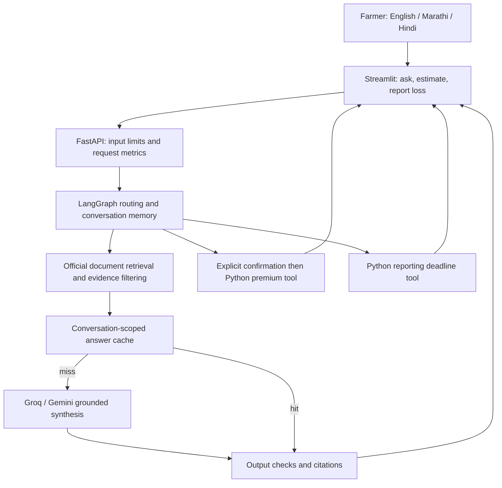
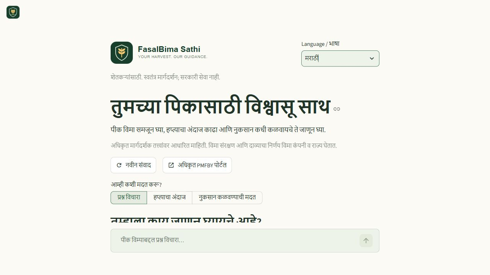

# FasalBima Sathi

[](https://github.com/omkadam78/GenAI-Traning-Program/actions/workflows/ci.yml)

Crop insurance guidance farmers can understand: ask in English, Marathi or Hindi,
review a premium estimate, and prepare to report crop loss using official PMFBY sources.

## Final handoff — Day 14

Built by **Om Kiran Kadam · 2124UDSM2013**.
[Interview and 60-second pitch](docs/interview.md) · [Five-minute demo and recovery](docs/demo_runbook.md)
· [Project map](docs/project_map.md) · [Release checklist](PROGRESS.md)
· [Final verification](docs/day14_verification.md)
· [Engineering defense and evidence](docs/engineering_defense.md)
· [Follow-up verification](docs/day14_followup_verification.md)

The Day 14 implementation and tagged release are complete. The 24 November
follow-up adds a code-linked engineering defense and stored evaluation error
analysis. `PROGRESS.md` tracks implementation; personal rehearsal and Day 15
participation are tracked separately in `docs/presentation_preparation.md`. The app explains rules and prepares
estimates/reporting notes; it does not buy insurance, submit claims or access claim status.

## Day 13: production safeguards and measured results

[Watch the narrated farmer demo on Google Drive](https://drive.google.com/file/d/1SqBRUVHGCP8iX5eNJeH-B5WiEgFAyB5a/view)
· [Repository video](docs/demo.mp4) · [Demo details and transcript](docs/demo.md)
· [Production notes](docs/production_notes.md) · [Resume bullets](docs/resume.md)



### Production notes

Five exact-repeat question pairs measured locally with real retrieval and live Groq
on 21 November 2026; different request IDs, same conversation within each pair.

| Result | Measured value |
|---|---:|
| Passing repeat pairs | 5/5 |
| Median initial / cached request | 1,747.70 / 376.53 ms |
| Reduction between medians | 78.46% |
| Initial requests' reported tokens | 12,184 |
| Cached repeats' new provider calls / tokens | 0 / 0 |
| Offline automated tests | 120 passed |

These are local TestClient timings, not public Render latency or an answer-accuracy
score. The small sample does not measure farmer adoption or claim outcomes.
[Full results](eval/production_benchmark.json) and the
[unsuccessful first attempt](eval/production_benchmark_first_attempt.json) are retained.

The answer cache is bounded to 128 entries for 300 seconds and isolated by conversation;
anonymous requests bypass it. Evidence, prompts, language and provider configuration
are part of the key. Calculations, approvals and live deadline clocks are not cached.
Requests log latency, physical provider attempts and reported tokens without raw
questions or credentials. Missing usage remains unknown. Questions are limited to
2,000 characters and request bodies to 16 KiB. Tested injection patterns, poisoned
evidence and output leakage are guarded; this is not universal attack prevention.
See [limits and reproducible commands](docs/production_notes.md).

Reproduce the benchmark from the project root (no provider key needed):

```powershell
python -m eval.production_benchmark --mock --output test-results/cache-benchmark.json
```

For a fresh **live Groq** sample on Demo Day, keep the real key in your ignored
`.env` and run the following. It consumes quota and takes several minutes with
pacing; the timings are local TestClient measurements. Save a new report rather
than overwriting the original five-pair evidence:

```powershell
python -m eval.production_benchmark --live --env-file .env --output test-results/demo-day-live-benchmark.json
```

**Release status:** Verified live on Render on 21 November 2026. Merged via [PR #2](https://github.com/omkadam78/GenAI-Traning-Program/pull/2), validated by [main CI](https://github.com/omkadam78/GenAI-Traning-Program/actions/runs/44867204315), and auto-deployed to [https://fasalbima-sathi.onrender.com](https://fasalbima-sathi.onrender.com). Live verification confirmed public health with request metrics, WebSocket streaming, input limits (413/422), mandatory claim-status refusal, conversation-scoped caching (first MISS, second HIT with 0 provider calls, scope isolation), real Groq synthesis with official citations, and human-in-the-loop Python premium calculation and approval.

## Day 12: CI and live deployment

[CI runs and evidence](https://github.com/omkadam78/GenAI-Traning-Program/actions/workflows/ci.yml)
· [Feature-branch pull requests](https://github.com/omkadam78/GenAI-Traning-Program/pulls?q=is%3Apr)

CI runs Ruff lint/format, pytest with fake LLMs and a real Docker build.
The container smoke check exercises health, UI, WebSocket upgrade, records and Q6
refusal. JUnit XML, smoke results and startup logs are workflow artifacts. Actions
are pinned to verified commit SHAs with read-only permissions; PR checks use no
LLM secrets. A badge reports actual status, not an assumed green result.

**Live app:** https://fasalbima-sathi.onrender.com

**Public health:** https://fasalbima-sathi.onrender.com/health

Verified on 20 November 2026: public health, UI, WebSocket connection, records,
mandatory Q6 refusal, and real Groq answers with official citations. Render uses
the free plan in Singapore and deploys only after CI checks pass. The API key is
stored privately in Render, never in this repository.

[Required merged PR #1](https://github.com/omkadam78/GenAI-Traning-Program/pull/1)
· [Successful main CI](https://github.com/omkadam78/GenAI-Traning-Program/actions/runs/44707632275)

Free hosting can sleep after inactivity. Conversation state resets on restart and
feedback storage is ephemeral. First requests after sleep can take longer.
The image serves UI at `/`, public health at `/health` and API under `/api/` on
one port. See [hosting instructions](docs/deployment.md).

## Day 11: quality, Docker and a farmer-friendly interface

English, Marathi and Hindi are available from the language selector. The interface
keeps three clear actions: **Ask a question**, **Estimate premium** and
**Report crop loss**. A custom crop-and-shield logo appears in the header and corner,
with a matching favicon. No government affiliation is implied.



Premium estimates use verified Python tools and require confirmation. The reporting
screen includes a live deadline clock, a preparation checklist and a downloadable
reporting note. The note does not submit a claim. Never enter private identifiers.
Marathi/Hindi questions are translated for retrieval, with numeric preservation
checks; grounded answers use the selected language. Language interpretation can
still be imperfect. English official source titles remain unchanged.

Live farmer answers require a configured provider. The LangGraph path reports a
provider failure rather than silently substituting templates. Premium and deadline
arithmetic remain deterministic. Groq generation was verified locally; Gemini
fallback generation has not been live-verified. Store keys only in ignored `.env`.

### Run with Docker

Requires a running Docker engine and Docker Compose v2.24 or newer. If ports 8000
or 8501 are already occupied, stop the old project instance first.

```powershell
# Only if .env does not already exist:
Copy-Item .env.example .env
# Edit .env with your provider keys; never commit it.
docker compose config --quiet
docker compose up --build
```

Open **http://localhost:8501**; API documentation is at
**http://localhost:8000/docs**. Compose starts the API before the UI, uses its
internal service address for UI requests, and includes health checks. First boot
builds the vector index and may download an embedding model. Internet access is
needed for package/model downloads and live LLM calls. Named volumes retain the
index, model cache and feedback; the image does not contain `.env` or local feedback.

```powershell
docker compose run --rm --no-deps api python -m pytest -q
docker compose run --rm --no-deps api python -m ruff check .
docker compose down
```

**Day 12 verification:** GitHub's Linux CI built the Docker image and verified both
single-port container startup and separate Compose API/UI services. The 82-test
pytest suite passed in the Linux CI quality job. Docker remains unavailable on
the local Windows machine. [Day 11 verification](docs/day11_verification.md) is the
historical record before these CI checks.

### Run locally and check quality

```powershell
python -m pip install -r requirements-dev.txt
python run.py
# Separate terminal:
python -m pytest -q
python -m ruff check .
python -m ruff format --check .
```

The launcher starts a matching API/UI pair. Custom ports are supported with
`python run.py --backend-port 8050 --ui-port 8550`. The current local verification
uses **http://127.0.0.1:8550**. Tests run offline with fake LLM responses and isolated
feedback storage. Day 13 result: **120 passed**; see the verification report.

## Problem
Farmers often face difficulty understanding crop insurance guidelines, premium calculations, claim procedures, and statutory deadlines (such as the 72-hour localized calamity intimation window).

## Target Users
- Indian farmers (e.g., soybean, wheat, and cotton cultivators facing crop loss)
- Small and marginal farmers navigating statutory insurance benefits
- Agricultural extension workers and PACS (Primary Agricultural Credit Societies)

## Project Objectives
- Explain official PMFBY rules clearly and transparently.
- Provide pure arithmetic sum insured and premium calculations with documented statutory rates.
- Protect farmers from unauthorized calculations via human-in-the-loop approval gates.
- Track localized calamity intimation deadlines (72-hour rule) with real-time countdowns.
- Ground all advice with genuine citations (source PDF and page number) from official guidelines.

## Official Data Sources
- [PMFBY FAQ Portal](https://pmfby.gov.in/faq)
- [PMFBY Revamped Operational Guidelines (Kharif 2020 onwards)](https://pmfby.gov.in/pdf/Revamped%20OGs_Final.pdf)
- [PMFBY Revised Operational Guidelines (2016)](https://pmfby.gov.in/pdf/Revised_Operational_Guidelines.pdf)

---

## Current Progress (Days 1–14)
- **Day 1**: Python intro (`day01_intro.py`) and interactive menu (`day01_menu.py`).
- **Day 2**: 20 starter PMFBY records (`data/sample_records.py`), reusable record utilities (`app/records.py`), and terminal CLI (`app/cli.py`).
- **Day 3**: Official source downloader with manifest (`app/fetch.py`), `Record` dataclass (`app/models.py`), and PDF/HTML ingestion pipeline (`app/ingest.py` -> `data/records.json`).
- **Day 4**: FastAPI service (`app/main.py`), TF-IDF + cosine similarity search (`app/smart_search.py`), and pandas dataset analysis (`analysis/explore.py`).
- **Day 5**: LLM fundamentals guide with diagram (`docs/how_llms_work.md`) and 10 evaluation questions (`eval/questions.json`, `docs/questions.md`).
- **Day 6**: LLM provider wrapper supporting Groq & Gemini with offline rule fallback (`app/llm.py`), prompt engineering templates (`prompts/system_prompt.txt`, `prompts/task_v1_concise.txt`, `prompts/task_v2_detailed.txt`), `POST /chat` returning structured JSON (`answer`, `confidence`, `follow_up`), configuration template (`.env.example`), and evaluation report comparing both prompt versions (`eval/prompt_compare.md`).
- **Day 7**: Document chunking pipeline preserving source, page, and title (`app/chunking.py`), dense semantic embedding utilities (`app/embed.py`), persistent Chroma vectorstore (`app/vectorstore.py` with 1,786 indexed chunks), `GET /search/semantic` endpoint, and semantic evaluation report on 10 questions (`eval/search_results.md`).
- **Day 8**: Grounded RAG engine with strict citations and personal claim refusal (`app/rag.py`), `POST /ask` endpoint, 15-question evaluation suite (`eval/eval_set.json`), dual-configuration experiment script (`eval/run_eval.py`), and configuration winner table.
- **Day 9**: Agent tools (`app/tools.py` with pure arithmetic `pmfby_premium`, `pmfby_knowledge_search`, and `pmfby_claim_deadline_check`), hand-written ReAct loop (`app/agent_loop.py`), stateful LangGraph agent with native `interrupt()` and `Command(resume=...)` approval pause (`app/graph.py`), and unified `POST /agent` endpoint.
- **Day 10 (Checkpoint 2)**: Streamlit interface, live 72-hour clock, calculation approval, official citations and scoped feedback.
- **Day 11**: Offline pytest coverage, Ruff lint/format configuration, Dockerfile and Compose services, documented run commands, and English/Marathi/Hindi farmer interface with custom branding and reporting checklist.
- **Day 12**: Green Ruff/pytest/Docker CI, feature-branch PR #1 merged after checks, and a verified live Render deployment with public health and real Groq answers. Container and Compose startup evidence is retained in CI artifacts.
- **Day 13**: Request metrics, bounded conversation cache, input limits, injection regression tests, five-pair live benchmark, farmer demo and resume bullets. [Verification and release handoff](docs/day13_verification.md).
- **Day 14**: Interview pitch and ten technical answers, evidence-backed failure stories, project map, timed demo/recovery runbook and final release checklist. [Current verification](docs/day14_verification.md); personal rehearsals and Day 15 viva are recorded separately.

---

## Streamlit behavior retained from Day 10

New sessions start empty. Premium calculations pause for explicit approval bound
to an immutable calculation ID. Date and time are required for loss reporting, with
an IST countdown refreshed every five seconds. Official citations remain clickable.
Feedback is scoped per conversation and excluded from Git. Technical controls and
internal tool traces are kept out of the farmer flow. The UI uses the API over HTTP;
a connection failure is shown clearly without switching to a hidden local engine.

---

## Day 9: Agent architecture and validation

### 1. Pure Arithmetic Premium Tool (`app/tools.py`)
- **Sum Insured**: $\text{Scale of Finance} \times \text{Insured Area}$.
- **Units Isolation**: Tracks `area_unit` (`ha`, `acre`) and `scale_of_finance_unit` (`per_ha`, `per_acre`) separately. Correctly converts $1 \text{ acre} = 0.404686 \text{ ha}$ when units are mixed, and rejects unsupported units (`bigha`, `guntha`).
- **Precision**: Uses Python `Decimal` with `ROUND_HALF_UP` quantization to ₹0.01.
- **Strict Validation**: Rejects booleans (`True`/`False`), NaN, infinity, negative or zero amounts, and invalid actuarial rates ($\le 0\%$).
- **Statutory PMFBY Caps (Para 13.1 Table 1)**:
  - Kharif food grains & oilseeds: **2.0%**
  - Rabi food grains & oilseeds: **1.5%**
  - Annual commercial & horticultural crops: **5.0%**
- **Estimated vs Exact**: Labels results as an **Estimated Maximum Farmer Premium** when district actuarial tender rates are unnotified, and computes exact farmer share when tender rate is provided ($\min(\text{cap}, \text{actuarial})$).

### 2. Intimation Deadline Clock (`app/tools.py`)
- Evaluates in `Asia/Kolkata` (IST) with injectable clock for deterministic testing.
- Parses ISO timestamps (`YYYY-MM-DD HH:MM`) and relative strings (`yesterday at 9 pm`, `12 hours ago`).
- Requires both date and time (rejects date-only strings without loss time).
- Rejects future dates and unparseable formats.

### 3. Stateful LangGraph with Native Interrupt (`app/graph.py`)
- **Native `interrupt()` & `Command(resume=...)`**: Human-in-the-loop approval step genuinely halts the graph state in `MemorySaver` until user confirmation is received.
- **Parameter & ID Binding**: Binds approval to the exact pending calculation ID (`calc_<uuid>`) and immutable parameters; rejects mismatched or outdated IDs.
- **Replay Protection**: Once approved or cancelled, the pending calculation is cleared. Duplicate resume attempts are rejected.
- **Conversation Isolation**: Memory is strictly isolated per unique `thread_id` (no shared default session).
- **Compound Queries**: Answers every supported part (premium calculation, 72-hour deadline, and reporting channels).
- **Memory Lifespan**: `MemorySaver` checkpointing maintains state in RAM across turns in the process runtime; in-memory checkpoints do not persist across server restarts.

---

## RAG Evaluation: 2 Configurations Comparison

The evaluation in `eval/run_eval.py` tests 15 scenarios from `eval/eval_set.json` (13 answerable PMFBY guideline scenarios + 2 mandatory refusal queries Q6 and Q15).

> [!NOTE]
> **Methodology & Historical Context**:
> - **Historical Day 8 Benchmark**: Reported a 93.3% keyword hit score based on searching a shared collection and checking whether keywords appeared anywhere in retrieved text.
> - **Day 10 Rigorous Evaluation**: Each chunk-size configuration indexes and queries its own isolated Chroma collection (`fasalbima_chunks_400` vs `fasalbima_chunks_750`) without cache collisions, and evaluates retrieval recall, answer correctness (requiring synthesized answers to contain necessary facts), citation validity, and refusal precision separately.

| Configuration | Collection | Chunk Size | Top-K | Evidence Support | Heuristic Answer Accuracy | Refusal Accuracy (Q6 & Q15) | Citation Completeness | Overall Accuracy | Avg Latency | Result |
| :--- | :--- | :--- | :--- | :--- | :--- | :--- | :--- | :--- | :--- | :--- |
| **Config A (Compact / top-3)** | asalbima_chunks_400 | 400 chars | 3 | 69.2% | 53.8% | 100.0% | 100.0% | 60.0% | 345.5 ms | Alternative |
| **Config B (Broader Context / top-5)** | asalbima_chunks_750 | 750 chars | 5 | 84.6% | 69.2% | 100.0% | 100.0% | 73.3% | 348.4 ms | **WINNER** |

**Winner Analysis**: **Config B** provides superior semantic context retention across complex multi-clause PMFBY rules (such as prevented sowing, post-harvest drying windows, and localized calamity timelines) without fragmenting legal clauses across chunk boundaries.

---

## How to Run

### 1. Setup Environment
```powershell
python -m venv .venv
.\.venv\Scripts\Activate.ps1
python -m pip install -r requirements.txt
```

### 2. Configure Environment (Optional - LLM API Keys)
```powershell
Copy-Item .env.example .env
```
Never commit `.env`. Set a valid provider/key for live farmer answers. Explicit offline rule mode is available for development; it is not live inference.

### 3. Fetch & Ingest PMFBY Data
```powershell
python -m app.fetch
python -m app.ingest
```

### 4. Index Chroma Vectorstore
```powershell
python -m app.vectorstore
```

### 5. Run RAG Evaluation Benchmark
```powershell
python -m eval.run_eval
```

### 6. Start the FastAPI Backend Server
```powershell
python -m uvicorn app.main:app --host 127.0.0.1 --port 8000 --reload
```
Interactive API documentation available at `http://127.0.0.1:8000/docs`.

Key Endpoints:
- `GET /health`: Service health and records count
- `GET /records`: View loaded PMFBY records
- `GET /search/semantic?q=hailstorm`: Vector search over Chroma collection
- `POST /ask`: RAG question answering with citations (strictly refuses private claim queries with `"I don't know"`)
- `POST /agent`: Agent endpoint supporting LangGraph (with interrupt approval & memory) and hand-written ReAct loop
- `POST /claim-clock`: 72-hour localized calamity intimation countdown and authorized reporting channels
- `POST /feedback` & `GET /feedback`: Thumbs-up/down feedback collection and retrieval with deduplication

### 7. Launch the Streamlit Web Application (Day 10)
```powershell
python -m streamlit run ui/app.py --server.port 8501
```
Open `http://localhost:8501` in your browser.

### 8. Run Complete Test Suite
```powershell
python -m pytest -v
```

---

## Disclaimer
Information from official PMFBY guidelines, not insurance or legal advice. Claim decisions rest with the insurance company and the state government. This application calculates deadlines and estimates statutory premiums; it does not file formal insurance claims.
