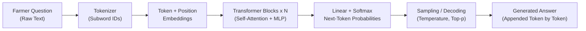

# How Large Language Models (LLMs) Work

An explanation in my own words, connecting LLM fundamentals to **FasalBima Sathi** (our PMFBY crop insurance assistant).

## 1. From Text to Numbers: Tokenization and Embeddings
Computers cannot read words directly. An LLM first splits input text (for example, a farmer asking *"Is hailstorm covered for my soybean?"*) into small pieces called **tokens** (whole words, subwords, or punctuation). Each token is mapped to an integer ID, and then looked up in an **embedding table** to turn it into a dense vector of numbers. Tokens with similar meanings end up close together in this vector space.

## 2. Understanding Context with the Transformer
The core architecture behind modern LLMs is the **Transformer**. Inside a stack of Transformer layers, two main blocks work together:
- **Self-Attention**: Every token looks at all earlier tokens in the prompt to figure out which words matter most to each other. For example, in *"72 hours for localized hailstorm, 14 days for post-harvest"*, attention links *"72 hours"* to *"hailstorm"* and *"14 days"* to *"post-harvest"*.
- **Feed-Forward Networks (MLP)**: Each token's updated representation is transformed through learned neural weights, building higher-level concepts like crop insurance rules, timelines, and version differences.

Positional encodings tell the model token order, and residual connections + layer normalization keep deep networks stable during training.

## 3. Next-Token Prediction and Sampling
At the end of the Transformer stack, a linear layer and **softmax** convert the final vector into a probability distribution over the entire vocabulary. The model predicts **one token at a time**, appends that token to the context, and repeats until it finishes the answer:
- **Low temperature (e.g., 0.0–0.2)**: Picks high-probability tokens — best for factual rule lookup like FasalBima Sathi deadlines (`72 hours`, `2%`).
- **Higher temperature**: Allows more varied phrasing, but increases risk of hallucination.

## 4. Training Stages: Pretraining vs. Post-Training
1. **Pretraining**: The model trains on massive text corpora to predict the next token, learning grammar, world knowledge, and reasoning patterns.
2. **Supervised Fine-Tuning (SFT) & Alignment (RLHF/DPO)**: The model is trained on instruction-response examples and human preference feedback so it follows instructions, answers helpfully, and refuses or admits uncertainty when appropriate.

## 5. Architecture Diagram

## 6. Why Grounding Matters for FasalBima Sathi
An LLM only knows patterns from its training data—it does **not** know live state notifications, your personal policy number, or whether the 2016 vs. 2020 PMFBY Operational Guidelines apply unless we give it verified context. That is why our roadmap moves from **TF-IDF search (Day 4)** to **RAG with citations (Days 7–8)**, ensuring:
- Answers cite the exact PMFBY Operational Guideline version (`Revamped OG (Kharif 2020)` vs. `2016 OG`).
- Personal status questions (such as *"Has my PMFBY claim for kharif 2025 been approved?"*) receive an honest **"I don't know"** instead of a guessed answer.

